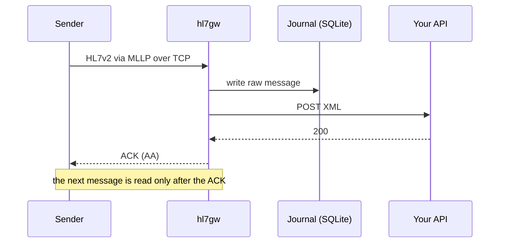

# hl7gw

A lightweight, self-hosted HL7v2 gateway that's delightfully simple to run and operate.

- **One self-contained binary.** No dependencies to wrangle, no database servers, nada.
- **One simple config file.** JSON, with secrets read from environment variables.
- **Observable by default.** Structured logs, Prometheus metrics and health probes with no setup.

## Getting started

**1. Download the binary**

```sh
curl -fsSL "https://github.com/bltn/hl7gw/releases/latest/download/hl7gw_$(uname -s)_$(uname -m).tar.gz" | tar -xz
```

**2. Set up your config file**

hl7gw runs against a single JSON file that defines the admin API and one or more channels. Example below:

```json
{
  "admin_api": { "port": 8081, "token_env": "HL7GW_ADMIN_TOKEN" },
  "channels": [
    {
      "name": "adt",
      "tcp_listener": { "port": 2575, "idle_timeout_seconds": 60, "tls": { "mode": "off" } },
      "destination": {
        "url": "https://your-api.example.com/hl7",
        "auth": { "type": "bearer", "token_env": "ADT_API_TOKEN" }
      }
    }
  ]
}
```

See [docs/configuration.md](docs/configuration.md) for every option.

**3. Run it**

```sh
export HL7GW_ADMIN_TOKEN=change-me ADT_API_TOKEN=your-api-token
./hl7gw -config hl7gw.json
```

**4. Explore the admin API**

For now, at least, the admin API (gated by `admin_api.token` in your config file) is the best way to operate a running instance.

Run the binary and then open [http://localhost:8081/docs](http://localhost:8081/docs) for the full API reference, with a description of every endpoint.

## Message flow



The main thing to be aware of is that, for now, hl7gw only has one ACK model: on downstream delivery (or failure to do so). There's no ACK'ing as soon as the message arrives/has been persisted. This is deliberately conservative. What you lose in maximum throughput, you gain in simplicity and reliability:

- **No queues.** Nothing to run, size or drain.
- **An ACK is a real ACK.** `AA` means delivered, not "accepted, will forward
  later".
- **Built-in backpressure.** Senders slow down to your API's pace on their
  own.

## Documentation

- [ARCHITECTURE.md](ARCHITECTURE.md): the full message lifecycle, failure behaviour, design trade-offs and a map of the code.
- [docs/configuration.md](docs/configuration.md): every config dial, plus hard-coded limits.
- [docs/observability.md](docs/observability.md): structured logs, Prometheus metrics and health probes.
- The admin API reference is served by a running instance at
  [http://localhost:8081/docs](http://localhost:8081/docs).

## Development

```sh
make build        # bin/hl7gw
make run          # go run .
make check        # lint, unit + e2e tests with a 100% coverage gate & short fuzzing run
make e2e_tests    # black-box tests against the built binary
make fuzz FUZZTIME=30s
make dist         # release archives + checksums into dist/
```
